# Icons

This is a set of custom made icons to be used with FMI observation and forecast data. The icons are drawn programmatically - not with an SVG editor. Some icons have day and night variants. There are still some icons missing. Those will be added later.

## Weather icons

### General

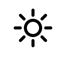

### Drizzle (+ with icing)

### Mist and fog

### Hail

### Rain (+ with icing)

### Sleet

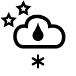

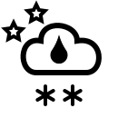

### Snow

### Thunder

### Precipitation

### Ice pellets

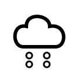

## Miscellaneous

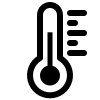
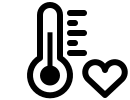
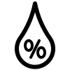

## Battery level

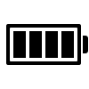
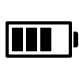
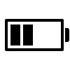
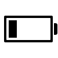

## Signal strength

## Cloud cover

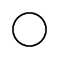

## Backgrounds

